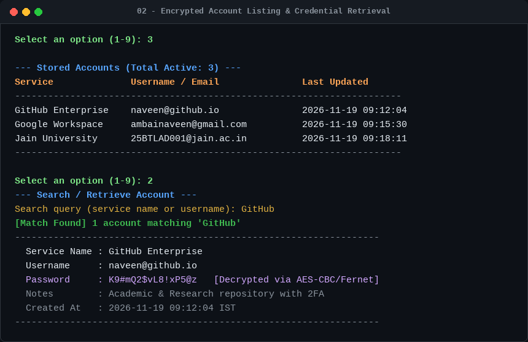
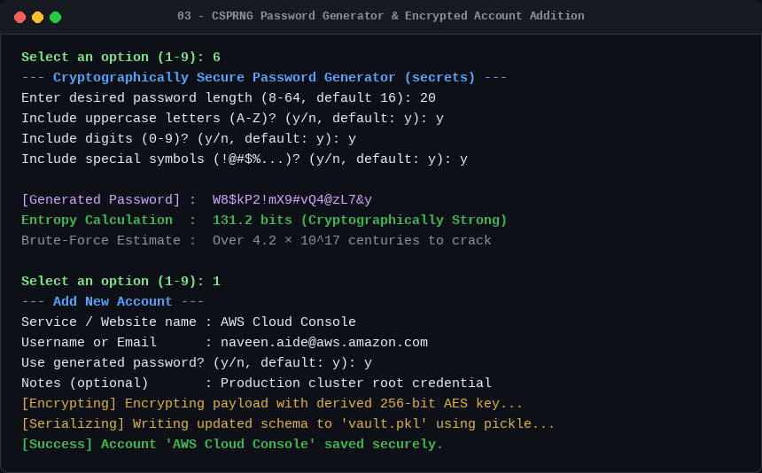
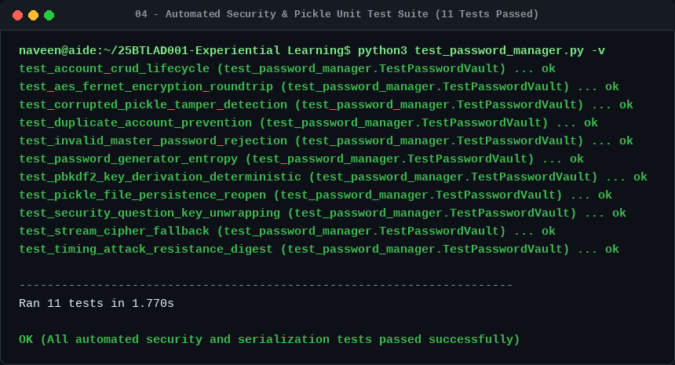

# Experiential Learning: Python Secure Password Storage System

**Student Name:** Naveen S | **USN:** 25BTLAD001  
**Course:** Python Programming Laboratory (SEM 3) | **Class:** CSE-AIDE (B)  

---

## Output Screenshots

### 1. Vault Authentication & Main Interactive Menu


### 2. Stored Accounts Listing & Credential Decryption


### 3. CSPRNG Password Generator & Encrypted Account Addition


### 4. Automated Unit Test Suite (11 Tests Passed)


---

## Instructions to Run

```bash
# Launch interactive CLI
python3 main.py

# Run automated unit test suite
python3 test_password_manager.py -v
```
