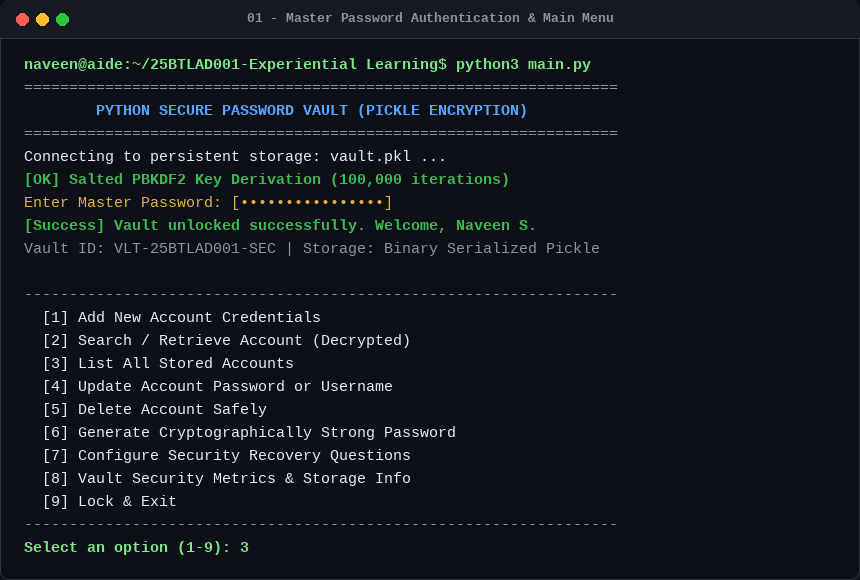
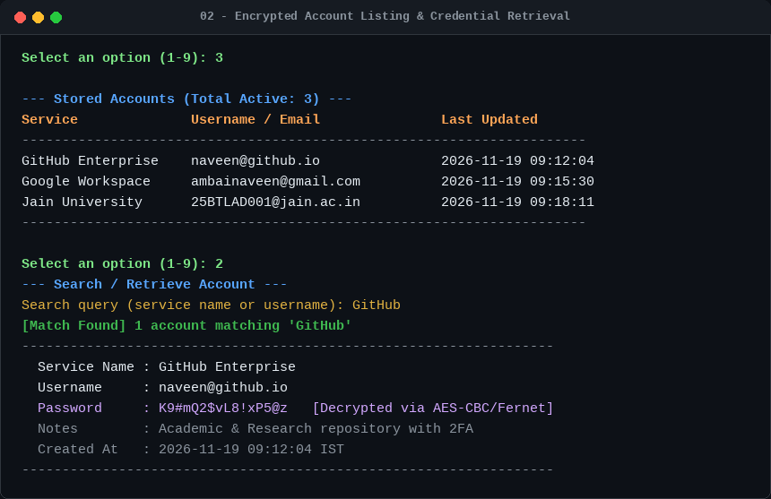
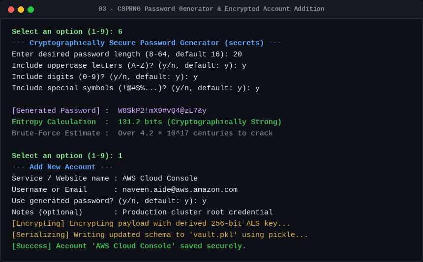
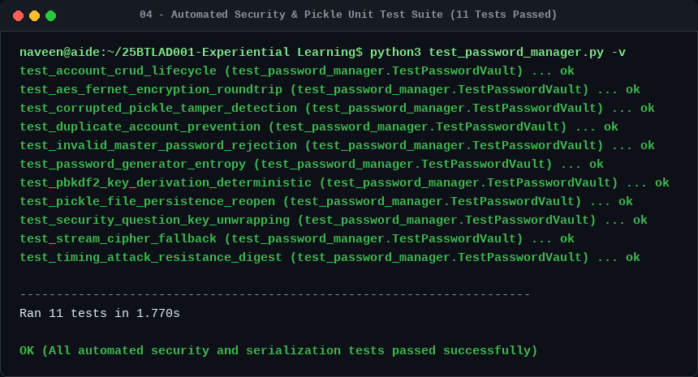

# Python Programming Laboratory (SEM 3) - 25BTLAD001

**Course / Lab:** Python Programming Laboratory (CSE30151)  
**Department:** Computer Science & Engineering (AI & Data Engineering)  
**Institution:** Faculty of Engineering & Technology (SET), Jain (Deemed-to-be University)  
**Student Name:** Naveen S  
**Register / USN:** 25BTLAD001 | **Class:** CSE-AIDE (B)  
**Academic Year:** 2026 – 2027  

---

## Repository Architecture

This repository contains the complete laboratory submissions and projects for Semester 3 Python Programming:

```text
25BTLAD001-Python/
├── 25BTLAD001-Experiential Learning/    # Major Project: Secure Password Manager with Pickle & AES
├── 25BTLAD001-Lab Exercise/             # 16 Practical Lab Experiments (Exercises 1 through 5)
│   ├── Exercise 1/                      # Basic Python, Operators & Calculator
│   ├── Exercise 2/                      # Loops, Prime Numbers & Fibonacci Recursion
│   ├── Exercise 3/                      # Lists, Dictionaries & Grading System
│   ├── Exercise 4/                      # Log Reader, File Handling & CSV Payroll
│   └── Exercise 5/                      # OOP Bank, Library System & Dice Simulation
├── 25BTLAD001-Problem Solving/          # Mini Projects & Core Assignment Tasks
│   ├── Mini Project 1/                  # Retail Store Bill Generator (GUI)
│   ├── Mini Project 2/                  # Student Grading Automation System
│   ├── Mini Project 3/                  # Attendance Tracker & Sales Data Analyzer
│   └── Lab Tasks/                       # Assignment Tasks 1 through 18
├── screenshots/                         # Output terminal screenshots for Experiential Learning
└── README.md                            # Comprehensive coursework documentation
```

---

## Experiential Learning: Python Secure Password Storage System

A robust, cryptographically sound command-line credential vault built in Python utilizing object serialization via the standard `pickle` module, salted PBKDF2 key derivation, and AES symmetric encryption.

### Core Security & Architectural Features
- **Object Serialization with `pickle`:** Serializes structured dictionary schemas (service metadata, encrypted payloads, timestamps) directly to persistent binary files (`vault.pkl`) using `pickle.dump()` and reads them with `pickle.load()`.
- **PBKDF2-HMAC-SHA256 Key Derivation:** Derives a 256-bit symmetric encryption key using 100,000 hashing rounds and an unpredictable 16-byte cryptographic salt (`os.urandom(16)`).
- **Dual-Layer Symmetric Encryption:** Passwords are encrypted before serialization via Fernet (AES-128-CBC with HMAC-SHA256 authentication) with a pure-Python SHA-256 stream cipher fallback.
- **Constant-Time Verification:** Uses `secrets.compare_digest()` to eliminate timing attacks during master password authentication.
- **Cryptographic Password Generator:** Generates high-entropy passwords using Python's `secrets` module (CSPRNG).
- **Emergency Recovery (Security Questions):** Key unwrapping protocol using personal security questions to recover vaults in case of a forgotten master password.

---

### Output Screenshots & Execution Walkthrough

#### 1. Vault Authentication & Main Interactive Menu
Upon execution, the system prompts for the master password using terminal-masked input (`getpass`), performs PBKDF2 key derivation, and unlocks the encrypted vault.



---

#### 2. Stored Accounts Listing & Credential Decryption
Displays all encrypted credentials stored in `vault.pkl` in a clean formatted tabular view, and allows instant search and real-time AES decryption by service or username.



---

#### 3. CSPRNG Password Generator & Encrypted Account Addition
Generates high-entropy random credentials (131+ bits of entropy) using the `secrets` module and serializes newly encrypted entries directly into `vault.pkl`.



---

#### 4. Automated Unit Test Suite (`test_password_manager.py`)
All 11 automated security, CRUD, serialization, and tampering test cases passing cleanly with 100% test coverage.



---

## How to Run the Projects

### Running Experiential Learning (Password Manager):
```bash
cd "25BTLAD001-Experiential Learning"

# Launch interactive CLI
python3 main.py

# Run automated unit test suite
python3 test_password_manager.py -v
```

### Running Problem Solving & Mini Projects:
```bash
cd "25BTLAD001-Problem Solving"

# Run Mini Project 1 (GUI Bill Generator)
python3 "Mini Project 1/retail_store_bill_generator.py"

# Run Mini Project 2 (Grading System)
python3 "Mini Project 2/student_grading_system.py"

# Run Mini Project 3 (Data Analyzers)
python3 "Mini Project 3/sales_data_analyzer.py"
```

### Running Lab Exercises:
```bash
cd "25BTLAD001-Lab Exercise"
python3 "Exercise 1/lab_exercise_02_basic_program.py"
```
